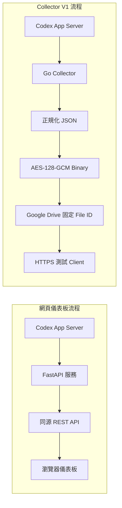

# Self-hosted Codex Usage Monitor 功能說明

## 文件範圍

本文件說明儲存庫中目前存在的兩個功能區：Python / FastAPI 網頁儀表板，以及 Go Codex Usage Monitor V1 Collector。兩者都能讀取 Codex 帳號的 rate-limit 狀態，但它們是**分開執行的流程**：網頁儀表板直接呈現 Codex App Server 資料；Collector 將資料正規化、加密後發布到 Google Drive。網頁儀表板不會讀取 Collector 發布的檔案，Collector 也不會呼叫網頁儀表板 API。

本文件只把目前程式碼與現行 V1 規格描述為已提供的功能。Android App、Widget、手機倒數、通知與使用歷史均不屬於目前 Collector V1 的交付範圍。

## 系統一覽

| 區域 | 主要程式 | 用途 | 執行方式 |
|---|---|---|---|
| 網頁儀表板 | `server/`、`web/` | 透過官方 Codex 登入後，在瀏覽器查看帳號與 rate limits | Docker Compose 常駐服務 |
| V1 Collector | `collector/` | 讀取 Codex 狀態、產生加密快照並更新固定 Google Drive File ID | Windows x64 命令列程式，每次執行處理一輪 |
| HTTPS 測試 Client | `collector/` 的 `--test-url` 模式 | 下載並驗證已發布的加密 Binary | Windows / Go 命令列操作 |

## 網頁儀表板

### 官方 Codex 登入

儀表板使用 Codex App Server 提供的官方 device-code 登入流程。瀏覽器會顯示驗證網址與 user code；登入完成後，伺服器才會允許帳號及 rate-limit 資料 API。使用者可以取消尚未完成的登入，或從儀表板登出。

瀏覽器只與同源的監控服務通訊。Codex 登入與憑證生命週期由伺服器端的 Codex App Server 管理，不由瀏覽器自行保存 OpenAI 憑證。

目前頁面與按鈕文字為英文；本文件以繁體中文解說介面操作。

### 帳號摘要

登入後的 **Account** 區塊顯示：

- `Authenticated`：Codex 帳號是否已驗證。
- `Auth mode`：來源提供的登入／帳號類型；來源沒有值時顯示 `Unknown`。
- `Plan`：來源提供的方案類型；來源沒有值時顯示 `Unknown`。

### Rate limits

**Rate limits** 區塊依來源提供的每個 limit 顯示一張卡片。卡片可呈現：

- limit 名稱；沒有名稱時使用 limit ID，再沒有時顯示 `Unknown limit`。
- Primary 與 Secondary window；不存在的 window 顯示 `Not available`。
- 已使用與剩餘百分比，以及以剩餘百分比表示的進度條。
- reset 時間；瀏覽器依目前的地區與時區格式化顯示。

已知的 300 分鐘 window 顯示為 `5 Hours`，10,080 分鐘顯示為 `Weekly`；其他 window 使用 `Primary` 或 `Secondary` 標籤。若百分比資料缺少或無效，畫面會顯示 `Usage unavailable`。儀表板支援多個 limit，不把產品模型限定為 5 小時與每週兩種。

畫面對百分比作 0–100 範圍限制，以避免異常來源值造成進度條越界；來源缺少或無法解析時不會猜測數值。

### Reset credits 與連線狀態

**Reset credits** 區塊顯示來源提供的 `Available` 數量；它是唯讀摘要，不會使用或消耗 reset credit。

頁面會顯示連線狀態與 `Last updated` 時間。`Last updated` 是這次頁面取得資料的時間，依瀏覽器時區格式化；rate-limit 資料在伺服器端預設快取 60 秒，因此重新載入頁面不保證在 60 秒快取期間重新向 Codex 讀取。

### 網頁 API 與存取界線

目前主要 API 路由如下：

| 路由 | 用途 |
|---|---|
| `GET /health` | 回報監控 HTTP 服務的基本健康狀態。它不等同於 Codex App Server 可用狀態。 |
| `GET /api/v1/login/status` | 取得安全化後的登入狀態與 device-code 顯示欄位。 |
| `POST /api/v1/login` | 啟動官方 device-code 登入。 |
| `POST /api/v1/login/cancel` | 取消尚未完成的登入。 |
| `POST /api/v1/logout` | 透過 Codex App Server 登出。 |
| `GET /api/v1/status` | 回報 Codex 執行階段為正常或降級。 |
| `GET /api/v1/account` | 回傳帳號已驗證狀態、auth mode 與 plan type。 |
| `GET /api/v1/rate-limits` | 回傳 rate limits 與 reset-credit 摘要。 |

除登入生命週期路由外，資料 API 需要伺服器端 Codex 登入狀態為 `COMPLETED`。遠端存取仍應使用受控網路與 HTTPS／Access 控制；Docker Compose 預設只將服務發布到本機 `127.0.0.1`。部署與遠端存取細節請見[部署指南](deployment.md)。

## Go Collector V1

### 資料處理流程

Collector 每次執行一次性完成以下流程：

1. 啟動官方 `codex app-server`，並依序執行 `initialize`、`initialized`、`account/read`、`account/rateLimits/read`。
2. 將帳號與 rate-limit 回應映射為固定的 V1 資料模型。
3. 以 UTF-8 JSON 序列化，並以 AES-128-GCM 加密成 Binary。
4. 透過 Google OAuth Desktop App 權杖，對設定的固定 File ID 發送一次 Google Drive media `PATCH`。
5. 只有發布成功後才記錄本輪成功。

Collector 不在背景持續監控，也不內建排程器。每次手動或外部排程啟動才會取得並發布一份新快照。

### V1 快照欄位

JSON 固定包含 `version`、`generatedAt`、`account`、`limits` 與 `resetCredits`：

| 欄位 | 說明 |
|---|---|
| `version` | JSON Schema 版本，目前為 `1`。 |
| `generatedAt` | 快照建立時間，使用 UTC RFC 3339 格式。 |
| `account` | `authenticated`、可為空的 `authMode` 與 `planType`。 |
| `limits[]` | 依 ID 穩定排序的 limit；包含 `id`、`name`、`primary`、`secondary`、`reachedType`。 |
| window | 包含 `usedPercent`、`remainingPercent`、`windowDurationMinutes`、`resetAt`；百分比以十進位字串保留精度。 |
| `resetCredits` | 來源有摘要時包含 `availableCount` 與可選的 credit 明細；來源缺少摘要時為 `null`。 |

來源未提供的 optional 欄位保留為 `null`。Collector 計算 `remainingPercent = clamp(100 - usedPercent, 0, 100)`，並將 reset 時間轉為 UTC。正式 V1 沒有 stale threshold，因此不會僅因快照時間較舊而拒絕資料。

### 加密與 Google Drive 發布

Binary 格式為 `MDF1` Magic、格式版本 `1`、隨機 12-byte nonce、AES-GCM ciphertext 與 16-byte authentication tag。Collector 先完成 Codex 讀取、正規化、序列化及加密，再聯絡 Google；前置階段失敗時不會呼叫 publisher。

發布只更新設定的單一 File ID，不搜尋檔名、不建立替代檔案、不刪除舊檔，也不先清空內容。更新失敗時，程式不會宣告成功或透過 Delete/Create 迴避失敗。

預設 OAuth scope 為 `drive.file`。程式只接受規格所列的 `drive.file` 或 `drive` scope，不會因 API 失敗自動擴大授權。使用較廣的 `drive` scope 前應先完成必要的權限決定與重新授權。

### HTTPS 測試 Client

Collector 的 `--test-url` 模式是驗證工具，不是 Android App。它不帶 Google OAuth 權杖，使用共用 AES Key 下載 HTTPS Binary，檢查 URL 與 HTTPS redirect、HTTP 狀態、大小上限、Magic／Binary 版本、GCM 驗證、UTF-8、JSON 版本、必要欄位與時間格式。Client 會拒絕 HTTP、HTTP downgrade、錯誤 Key、竄改內容及無效 schema；下載上限為 4 MiB，timeout 為 30 秒。

若來源是 Google Drive，供 Client 使用的 URL 必須能直接下載 Binary（使用 Drive metadata 的 `webContentLink`），不能使用瀏覽檔案頁面的 `/file/d/.../view` 網址。匿名 HTTPS 下載需要檔案權限允許知道連結的讀者存取；取得連結的人會拿到密文。能否解密仍取決於 AES Key 的保護。

## 安全與資料邊界

- OpenAI／Codex 登入狀態由執行 Codex App Server 的主機管理，不應放入瀏覽器、Google Drive JSON 或 Collector 命令輸出。
- Collector 的 Google OAuth Client Secret、Google token 與 AES Key 都是 Collector 主機端設定；不要提交到 Git、文件或共用 log。OAuth token 檔應放在 Repository 外，並限制本機 ACL。
- AES-GCM 可驗證密文完整性並避免直接閱讀 JSON；V1 的安全目標不是防止取得 Client 執行環境的人逆向取得共用 Key，也沒有 Key Server／KMS。
- 若 Google Drive 檔案可匿名下載，密文仍可能公開散布。任何同時取得密文與 Key 的人都可解密，因此 Key 不應與檔案連結一起公開。
- Web Dashboard 與 Go Collector 是兩套獨立路徑；修改 Collector 發布資料不會更新 Dashboard，Dashboard 登入也不會替 Collector 建立 Google OAuth token。

## 目前不提供的功能

- Android／iOS App、Widget、手機背景更新與通知。
- Usage 歷史資料庫、趨勢圖、報表匯出或帳務／API billing 報表。
- Collector 常駐服務、內建定時排程、資料歷史保留、stale threshold 或 heartbeat 檔。
- 透過監控頁面執行 Codex 指令或管理 ChatGPT 對話。
- 多使用者／多租戶權限管理。

## 規格與程式參考

- [Collector V1 正式規格](../collector/docs/01-codex-usage-monitor-v1-specification.md)
- [Collector 操作與環境變數說明](../collector/README.md)
- [網頁部署指南](deployment.md)
- [Dashboard HTML](../web/index.html) 與 [Dashboard 行為](../web/assets/app.mjs)
- [API 與服務實作](../server/app/main.py)
